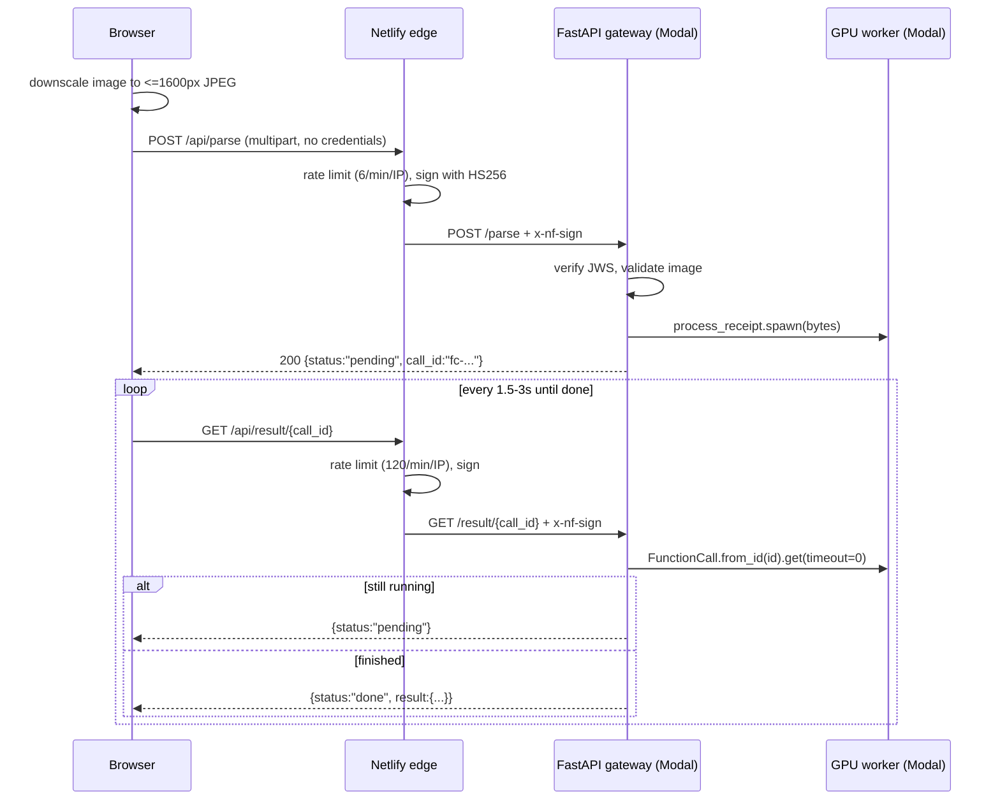

# Receipt Parser — Architecture

A receipt photo goes in, structured line items come out. Two deployables: a React
SPA on Netlify, and a single Modal app holding both the FastAPI gateway and the
GPU inference functions (Qwen3-VL).

---

## 1. System overview

```
┌─────────────────┐
│  Browser        │  React 19 + Vite SPA
│  (public)       │  Holds no credentials of any kind
└────────┬────────┘
         │  same-origin  /api/*
         ▼
┌─────────────────┐
│  Netlify        │  Static host + edge proxy
│  edge           │  • signs each proxied request (HS256 JWS -> x-nf-sign)
│                 │  • enforces per-IP rate limits
│                 │  • holds NETLIFY_SIGN_SECRET (never sent to browser)
└────────┬────────┘
         │  https + x-nf-sign
         ▼
┌─────────────────────────── Modal app: receipt-parser ───────────────────────┐
│                                                                             │
│  ┌─────────────────┐                      ┌─────────────────┐               │
│  │  gateway.py     │  process_receipt     │  funcs.py       │               │
│  │  gateway_image  │  .spawn()            │  inference_image│               │
│  │  (slim, CPU)    │ ───────────────────▶ │  (ML, GPU)      │               │
│  │                 │                      │                 │               │
│  │ • verifies JWS  │                      │ preprocess ->   │               │
│  │ • spawns jobs   │                      │ Qwen3-VL ->     │               │
│  │ • polls results │                      │ normalize       │               │
│  └─────────────────┘                      └─────────────────┘               │
└─────────────────────────────────────────────────────────────────────────────┘
```

One Modal app, two images. A Modal app is a deployment namespace, not a resource
boundary — GPU is requested per function — so the gateway stays CPU-only and
slim while the workers get the full ML stack. One `modal deploy` covers both,
and the gateway calls `process_receipt.spawn()` by direct Python reference
rather than resolving another app by string name.

The browser never talks to Modal directly, and never possesses a secret. That is
the central design constraint — see §5.

---

## 2. Request lifecycle

Parsing is **asynchronous**. A cold GPU start takes ~65s, which exceeds both the
Netlify proxy timeout (26s) and any reasonable browser wait, so the upload and
the result are two separate round trips.



Timings measured against production:

| Path | Latency |
|---|---|
| Cold start (first parse after idle) | ~66s |
| Warm parse | ~3.4s |
| `/parse` spawn (returns immediately) | <1s |
| `/result/{id}` poll | ~0.2s |

Because every HTTP call is now sub-second, the 26s proxy ceiling never binds.

---

## 3. Components

### 3.1 Frontend — `receipt-parser-frontend/`

Vite + React 19, deployed to Netlify.

| File | Role |
|---|---|
| `src/App.jsx` | Layout; owns `parsedData` plus a pristine `lastParsed` copy |
| `src/components/UploadForm.jsx` | File select, downscale, upload, poll, progress/error UI |
| `src/components/ReceiptTable.jsx` | Editable item table, per-buyer totals |
| `src/components/HealthCheck.jsx` | Calls `/api/health` |
| `netlify.toml` | Proxy rules, signing, rate limits |

Backend files:

| File | Role |
|---|---|
| `backend/config.py` | The Modal app, both image definitions, shared constants |
| `backend/gateway.py` | FastAPI routes + auth — **deploy entrypoint** |
| `backend/funcs.py` | GPU pipeline |
| `backend/requirements-gateway.txt` | 4 deps for the gateway image |
| `backend/requirements-gpu.txt` | Full ML stack for the inference image |

**Client-side downscaling.** Netlify caps request bodies at 6MB, ~4.5MB once
binary is base64-encoded. Phone photos routinely exceed that, so `UploadForm`
re-encodes to at most 1600px on the long edge at JPEG q=0.85 before upload.
Images already under 2MB with no resize needed are passed through untouched.

**Polling.** Starts at 1.5s, backs off ×1.3 to a 3s ceiling, gives up at 150s.
A `cancelledRef` stops the loop on reset or unmount so no orphaned poll survives.

### 3.2 Netlify edge — `receipt-parser-frontend/netlify.toml`

Every backend call is a same-origin `/api/*` request that Netlify rewrites to
Modal. Two things happen at this hop:

**Signing.** `signed = "NETLIFY_SIGN_SECRET"` makes Netlify attach an HS256 JWS
in the `x-nf-sign` header:

```json
{ "iss": "netlify",
  "site_url": "https://alexs-receipt-parser.netlify.app",
  "deploy_context": "production",
  "netlify_id": "…",
  "exp": 1623876755 }
```

**Rate limiting.** Per IP per domain:

| Route | Limit | Why |
|---|---|---|
| `/api/parse` | 6 / 60s | Each accepted request costs GPU time |
| `/api/result/*` | 120 / 60s | One cold-start upload polls ~22 times |
| `/api/health` | 30 / 60s | Cheap, but not free |

Exceeding a limit returns `429`, which `UploadForm` surfaces as a readable
message. Rate limits are honoured **only** in `netlify.toml`, never in a
`_redirects` file. `window_size` may not exceed 180s.

The SPA fallback (`/*` → `/index.html`) must stay last so it does not shadow the
`/api` rules.

### 3.3 Gateway — `backend/gateway.py`

FastAPI served by Modal (`@modal.asgi_app()`) on `gateway_image` — fastapi,
modal, PyJWT, python-multipart, and nothing else. This image's cold start is on
the critical path of every request, so it deliberately excludes the ML stack.

It is also the deploy entrypoint: importing `funcs` registers the GPU functions
on the same app, so `modal deploy backend/gateway.py` covers everything.

| Endpoint | Auth | Purpose |
|---|---|---|
| `GET /health` | public | Uptime probe |
| `POST /parse` | signed | Validate image, `spawn()` job, return `call_id` |
| `GET /result/{call_id}` | signed | Poll — `pending` / `done` / `410 expired` |

`verify_netlify_signature` is a **FastAPI dependency**, not an HTTP middleware.
This is deliberate: `HTTPException` raised inside a middleware bypasses FastAPI's
exception handlers and surfaces as a `500`. The previous bearer-token middleware
had exactly that bug — rejections returned 500 instead of 401.

Verification pins `algorithms=["HS256"]` (blocking `alg=none` forgery) and
additionally asserts `iss == "netlify"`.

Upload validation: content-type must start with `image/`, body must be non-empty
and ≤6MB (`400` / `413`).

### 3.4 GPU functions — `backend/funcs.py`

Same Modal app, `inference_image`. Model is `Qwen/Qwen3-VL-4B-Instruct`, cached
in a Modal Volume (`hf-hub-cache`) mounted at `/root/models`, running on a
pinned `L4`.

torch, transformers, cv2, and numpy are imported inside an
`inference_image.imports()` block rather than at module scope. Without that, the
gateway — which imports this module to reference `process_receipt` — would try
to load the ML stack on its slim image and fail.

| Function | GPU | Role |
|---|---|---|
| `preprocess_image` | no | EXIF-correct orientation, resize ≤1920px, → PNG |
| `transcript_receipt` | L4 | Qwen3-VL inference, greedy, `retries=3` |
| `normalize_output` | no | Parse the model's JSON reply, coerce, cross-check totals |
| `process_receipt` | L4 | Orchestrates the three above via `.local()` |

`process_receipt` invokes the others with `.local()`, so the whole pipeline runs
inside one GPU container rather than as three remote hops.

These functions have no web decorator (`@modal.asgi_app()` / web endpoint), so
they are not internet-reachable at all — invoking them requires authenticated
access to the Modal workspace.

**Response shape:**

```json
{ "store": "ParknShop", "date": "2026-08-14", "total": 12.34,
  "line_sum": 12.34, "printed_total": 12.34,
  "items": [ { "name": "Apples", "qty": 3, "price": 5.99 } ] }
```

`price` is the **line total** for the row, not a unit price. The frontend sums
that column directly and never multiplies by `qty`; both sides are pinned to it
by test.

`total` is what the receipt printed when the model could read it, falling back
to the sum of the rows. `printed_total` and `line_sum` are the two readings kept
separate, so `ReceiptTable` can flag a disagreement — which is what a missed
(or, with a generative model, an invented) line item looks like.

#### Why Qwen3-VL rather than Donut

Donut (`donut-base-finetuned-cord-v2`) was replaced, not tuned. Its decoder emits
the CORD-v2 schema and nothing else, and that schema has no `store` or `date`
field — those two were structurally unreachable, which is why they were
hardcoded to `""`. It was also fine-tuned on ~1000 Indonesian receipt scans, a
poor match for phone photos of HK and US receipts.

Qwen3-VL is instruction-following, so the target schema is defined by the prompt
rather than by a fine-tune; it covers 32 languages and tolerates blur and
perspective far better. The costs of the swap are honest ones: ~8GB of weights
instead of ~800MB (slower cold start), and a model that can hallucinate a row
rather than merely miss one — which is exactly what the `printed_total` versus
`line_sum` check exists to surface.

Two things follow from the model being generative and are worth knowing before
editing `funcs.py`:

- **`PROMPT` is the schema.** There is no fine-tune backing it up. The line-total
  rule carries a worked example because that is the one convention the frontend
  cannot recover from if it breaks.
- **`normalize_output` distrusts the reply.** It recovers JSON from code fences
  and preamble, coerces currency symbols and separators, and drops rows named
  exactly `TOTAL` / `Subtotal` / `TAX` and similar — whole-name matches only, so
  "Total Wine Merlot" survives.

---

## 4. Secrets

| Name | Lives in | Used by | Purpose |
|---|---|---|---|
| `NETLIFY_SIGN_SECRET` | Netlify env (Runtime scope) **and** Modal `RECEIPT_PARSER_SECRET` — same value | Netlify edge signs, gateway verifies | Proves a request came through our Netlify site |

Exactly one secret. Use ≥32 bytes (`openssl rand -hex 32`); PyJWT warns below
that for HS256.

A previous `RECEIPT_API_KEY` gated the GPU functions against the gateway. Once
both live in one Modal app and the gateway holds a direct reference, that check
was the app authenticating itself to itself, and it was removed.

**No secret is available to the browser, by construction.** Only `VITE_`-prefixed
variables are inlined into the bundle by Vite, and there are none left.

---

## 5. Security model

### What is guaranteed

- **No credential ever reaches the browser.** This matters because it is not
  fixable by other means: anything the browser can obtain, the person operating
  the browser can obtain. Encrypting a key in the bundle requires shipping the
  decryption key; fetching one at runtime just moves it to the Network tab.
- **Modal is not directly addressable.** Requests without a valid `x-nf-sign`
  are rejected with `401`. A scanner that discovers the `modal.run` URL gets
  nothing, and the URL no longer appears in the frontend bundle at all.
- **Signatures expire.** The JWS carries an `exp`, so a captured token is
  short-lived — unlike the previous static key, which was valid forever.

### What is not guaranteed

**The Netlify `/api/*` routes are public.** Netlify signs and forwards a `curl`
exactly as it would a browser click. Rate limiting is what constrains this — 6
parses per minute per IP — not authentication. A distributed source across many
IPs would still get through.

Closing that gap requires proving a *human on your page* rather than proving the
*origin*: Cloudflare Turnstile (invisible, free, validated server-side — needs a
Netlify Function rather than a bare redirect) or real user login. Neither is
implemented; the rate limit is the current answer.

This is a deliberate decision, not an oversight. Turnstile would mean adding a
serverless function in front of `/api/parse` — roughly 80 lines, and the awkward
part is re-forwarding a multipart upload through it, near the 4.5MB ceiling. The
signal to revisit is Modal billing showing GPU usage that traffic doesn't
explain. Until then the rate limit is proportionate. `/api/result` and
`/api/health` would stay plain signed redirects either way; only the expensive
endpoint would need the check.

### Prior design, and why it was replaced

`VITE_API_KEY` was inlined into the public bundle at build time and served to
every visitor — verifiable with
`curl -s https://alexs-receipt-parser.netlify.app/assets/index-*.js | grep Bearer`.
`.gitignore` kept it out of git history but had no bearing on the deployed
bundle. CORS was the only real control, and CORS is enforced by browsers only.

---

## 6. Local development

`/api/*` exists only inside Netlify's proxy, so plain `npm run dev` cannot reach
the backend. Use the Netlify CLI:

```bash
npm install -g netlify-cli
cd receipt-parser-frontend
netlify dev            # applies netlify.toml redirects, loads env vars
```

> **Unverified:** Netlify's docs confirm `netlify dev` applies redirect rules and
> loads env vars for all scopes locally, but do not state whether the `signed`
> property is applied. If local requests come back `401`, signing is not being
> applied locally and a dev-only bypass in the gateway will be needed.

Backend tests run without network access by stubbing `modal` — see §8.

---

## 7. Deployment

Two deploys that must move together:

```bash
modal deploy backend/gateway.py   # gateway + GPU functions — deploy FIRST
git push                          # Netlify builds the frontend
```

One Modal command covers both halves, because importing `funcs` registers the
GPU functions on the same app.

Order matters: the live frontend sends credentials the new gateway does not
accept (and vice versa), so there is a brief window where parsing fails. Deploy
Modal first and keep the gap short, or teach the gateway to accept both schemes
temporarily for a zero-downtime cutover.

**The Modal URL is derived from the app name.** Renaming the app to
`receipt-parser` changed it:

```
old: https://yangalex1081--receipt-parser-api-fastapi-app.modal.run
new: https://yangalex1081--receipt-parser-fastapi-app.modal.run
```

`netlify.toml` has been updated to match — confirm against the URL that
`modal deploy` prints, since a mismatch means every proxied call 404s.

Netlify build settings live in the dashboard, not in `netlify.toml` — the file
intentionally declares redirects only, so it cannot override them. It sits in
`receipt-parser-frontend/` because that is the configured base directory.

---

## 8. Testing

`backend/tests/test_api.py` holds everything, in two tiers:

```bash
pytest backend/tests/ -v                              # offline only (fast, free)
RUN_LIVE=1 pytest backend/tests/ -v                   # + hit the deployment
RUN_LIVE=1 RUN_LIVE_PARSE=1 pytest backend/tests/ -v  # + a real GPU parse
```

**Offline** stubs `modal` and touches no network. It covers the gateway —

- Auth: unsigned / malformed / wrong-secret / expired / wrong-issuer / `alg=none`
  all → `401`; valid signature → `200`; `/health` stays public.
- Upload: non-image → `400`, empty → `400`, >6MB → `413`.
- Result: pending / done / expired (`410`) / job failure (`500`).

— and `normalize_output`, which is a pure function and therefore the cheapest
place for an extraction regression to surface. Those tests feed it the strings
a VLM actually emits: fenced JSON, a chatty preamble, currency symbols, a
hallucinated `TOTAL` row.

**Live** hits the real Netlify site and Modal app. It tests the deployment, not
the code: that Netlify signs, that Modal verifies, that `netlify.toml` points at
the right URL. If offline passes but live fails, the code is fine and the deploy
is misconfigured — that distinction is why both exist.

`RUN_LIVE_PARSE=1` adds the one test that exercises the model, asserting the
contract (items present, named, correctly keyed) rather than any specific
reading of the photo.

---

## 9. Known issues

**Extraction quality — unmeasured since the model swap.** The near-empty parses
that dominated this list had two causes, both now addressed: a 326-token
natural-language prompt fed to Donut's decoder, which only ever wanted the bare
`<s_cord-v2>` token, and Donut itself. `store` and `date` are extracted rather
than hardcoded, and the printed total is captured for cross-checking. None of
that is yet backed by numbers on real receipts — measuring it against a set of
HK and US phone photos is the open work.

**Timings in §2 predate the swap.** They were measured with Donut's ~800MB of
weights. Qwen3-VL-4B is ~8GB at bf16, so cold start will be materially longer
(the Modal Volume cache absorbs the download, not the load), and a warm parse
now includes generating up to 1024 decoder tokens. The numbers in that table
need re-measuring before they mean anything.

**Row keys.** `ReceiptTable` keys rows by array index. Safe while rows are only
appended and edited, but per-row delete now exists, so removing a middle row
shifts every later key. Inputs are fully controlled so values stay correct — it
is latent, not live. A stable per-row id would settle it, which means deciding
whether that id rides along in the payload sent back to the server.

**Vestigial root package.** The repo root has a `package.json` (axios plus vite
scripts, but no vite dependency) and its own `node_modules`, left from before the
frontend moved into `receipt-parser-frontend/`. Netlify builds from the
subdirectory, so it is unused — but it produces a second lockfile and invites
confusion about which directory to run npm in.

**Unverified rendering.** The theme tokens compile and no component hardcodes a
colour, but the dark-mode contrast and the sub-900px layout have not been looked
at in a browser.
